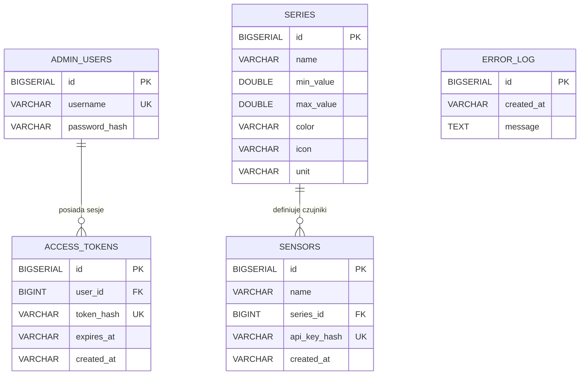

# Dokumentacja Projektu – ZAI 26Z: System Pomiarowy Jakości Powietrza

**Autor:** Marcel Dybek  
**Kierunek / Grupa:** Zaawansowane Aplikacje Internetowe – 26Z  
**Temat projektu:** System zbierania i wizualizacji serii pomiarowych czujników IoT (jakość powietrza)

| Warstwa                 | Technologie                                                                      |
|-------------------------|----------------------------------------------------------------------------------|
| Backend                 | Java 25, Spring Boot 4.1.2, Spring Data JPA, Spring Data MongoDB, Flyway, Lombok |
| Baza relacyjna          | PostgreSQL 16                                                                    |
| Baza szeregów czasowych | MongoDB 7 (natywne Time Series Collection)                                       |
| Frontend                | React 18, TypeScript, Vite, Recharts                                             |
| Infrastruktura          | Docker, Docker Compose, GitHub Actions CI/CD, Caddy (reverse proxy + SSL)        |

---

## 1. Adres aplikacji i repozytorium

| Zasób                  | Adres                                       |
|------------------------|---------------------------------------------|
| Aplikacja (frontend)   | `https://zai-marcel.duckdns.org`            |
| API (backend)          | `https://zai-marcel.duckdns.org/api`        |
| Health check           | `https://zai-marcel.duckdns.org/api/health` |
| Repozytorium GitHub    | `https://github.com/MDybek/zai-26z`         |
| GitHub Actions (CI/CD) | `https://github.com/MDybek/zai-26z/actions` |

Aplikacja jest wdrożona na serwerze VPS (Linode, Ubuntu) pod adresem IP `172.104.141.218`, obsługiwanym przez kontener
Caddy, który automatycznie pobiera i odnawia certyfikat TLS z Let's Encrypt dla domeny `zai-marcel.duckdns.org`.

---

## 2. Dane logowania konta administratora

| Parametr                          | Wartość                    |
|-----------------------------------|----------------------------|
| Nazwa użytkownika                 | `admin`                    |
| Hasło (środowisko lokalne / demo) | `BezpieczneHasloAdmin123!` |
| Endpoint logowania                | `POST /api/auth/login`     |

Hasło można zmienić przez `PUT /api/auth/password` (wymagany aktualny token Bearer) lub przez zmienną
środowiskową `ADMIN_PASSWORD` przed pierwszym uruchomieniem.

---

## 3. Instrukcja lokalnego uruchomienia

### 3.1 Wymagane wersje narzędzi

| Narzędzie      | Minimalna wersja     | Uwagi                                                 |
|----------------|----------------------|-------------------------------------------------------|
| Docker Engine  | 24.0+                | Silnik kontenerowy                                    |
| Docker Compose | v2.20+ (wtyczka CLI) | `docker compose version`                              |
| JDK            | 17+ (lub 25 jak CI)  | Temurin / OpenJDK; tylko dla uruchomienia bez Dockera |
| Node.js + npm  | 22 LTS / 10+         | Tylko dla uruchomienia frontendu bez Dockera          |
| Python         | 3.9+                 | Wymagany tylko dla skryptu `sensor.py`                |

### 3.2 Uruchomienie przez Docker Compose

Klonowanie i uruchomienie całego stosu jedną komendą:

```bash
git clone https://github.com/MDybek/zai-26z.git
cd zai-26z
docker compose up --build
```

Po kilkudziesięciu sekundach (czas budowy obrazów) dostępne są:

| Serwis           | URL                                    |
|------------------|----------------------------------------|
| Frontend (SPA)   | `http://localhost:3000`                |
| Backend REST API | `http://localhost:8080/api`            |
| Health check     | `http://localhost:8080/api/health`     |
| PostgreSQL       | `localhost:5432` (baza: `airquality`)  |
| MongoDB          | `localhost:27017` (baza: `airquality`) |

Dane logowania lokalnie: `admin` / `Admin123!`

### 3.3 Uruchomienie bez Dockera (tryb deweloperski)

#### Backend (Spring Boot):

```bash
cd backend
./mvnw spring-boot:run
```

Wymaga działającego PostgreSQL na `localhost:5432` i MongoDB na `localhost:27017` (lub uruchomienia tylko baz przez
Docker: `docker compose up postgres mongo`).

#### Frontend (Vite dev server):

```bash
cd frontend
npm install
npm run dev
```

Frontend nasłuchuje na `http://localhost:5173` i automatycznie przekierowuje żądania `/api/` do backendu
na `localhost:8080`.

### 3.4 Uruchomienie testów

```bash
# Testy jednostkowe i integracyjne backendu (JUnit 5 + MockMvc)
./test.sh --backend

# Weryfikacja typowania TypeScript i budowanie frontendu
./test.sh --frontend

# Oficjalne testy kontraktowe (zai-tests.mjs) uruchamiane przez prowadzącego
./test.sh --contract
```

Bezpośrednie uruchomienie testów Maven:

```bash
cd backend && ./mvnw test
# Oczekiwany wynik: Tests run: 9, Failures: 0, Errors: 0, Skipped: 0 — BUILD SUCCESS
```

### 3.5 Generator danych z czujników (`sensor.py`)

Skrypt `sensor.py` jest emulatorem IoT. Przesyła pomiary wyłącznie przez API`POST /api/measurements` z
nagłówkiem `X-API-Key`), bez bezpośredniego dostępu do bazy danych.

#### Opis parametrów:

| Parametr      | Wartość domyślna           | Opis                                                                          |
|---------------|----------------------------|-------------------------------------------------------------------------------|
| `--api`       | `http://localhost:8080`    | Bazowy adres API                                                              |
| `--api-key`   | (brak)                     | Klucz czujnika; jeśli pominięty, skrypt rejestruje nowy czujnik automatycznie |
| `--user`      | `admin`                    | Nazwa użytkownika administratora (do automatycznej rejestracji)               |
| `--password`  | `BezpieczneHasloAdmin123!` | Hasło administratora                                                          |
| `--seed`      | (flaga)                    | Automatycznie tworzy 3 serie (PM2.5, PM10, NO2) i 16 pomiarów każda           |
| `--count`     | `16`                       | Liczba pomiarów do wysłania na serię                                          |
| `--interval`  | `3600`                     | Odstęp czasu między punktami danych (sekundy)                                 |
| `--mode`      | `sine`                     | Tryb generowania: `sine` (sinusoida) lub `random` (losowy)                    |
| `--source`    | `simulated`                | Źródło danych: `simulated` mozliwe rozszerzenie o dane z live API)            |
| `--pollutant` | `pm2_5`                    | Zanieczyszczenie dla Open-Meteo: `pm2_5`, `pm10`, `nitrogen_dioxide`          |
| `--latitude`  | `52.23`                    | Szerokość geograficzna (Warszawa)                                             |
| `--longitude` | `21.01`                    | Długość geograficzna (Warszawa)                                               |
| `--live`      | (flaga)                    | Tryb ciągły – wysyłanie co `--interval` sekund w nieskończoność               |
| `--from`      | (brak)                     | ISO-8601 czas startowy dla backfill                                           |
| `--series`    | (brak)                     | ID serii; jeśli pominięty, skrypt seeduje wszystkie 3                         |

#### Przykładowe użycia:

```bash
python3 sensor.py --seed \
  --api https://zai-marcel.duckdns.org \
  --user admin --password 'BezpieczneHasloAdmin123!'
```

---

## 4. Diagram ERD i opis struktury bazy danych

Projekt korzysta z dwóch baz danych o różnym przeznaczeniu:

- **PostgreSQL 16** – przechowuje dane relacyjne: użytkowników, serie, czujniki, tokeny sesyjne i logi błędów.
- **MongoDB 7** – przechowuje pomiary jako natywna kolekcja Time Series (rozszerzenie – patrz sekcja 6).

### 4.1 Diagram ERD (PostgreSQL)



### 4.2 Schemat kolekcji MongoDB (pomiary)

```
measurements (Time Series Collection)
├── _id: ObjectId
├── seriesId: Long       ← pole metadanych (metaField)
├── sensorId: Long
├── value: Double
└── timestamp: Instant   ← pole czasu (timeField)

Indeks złożony: { seriesId: 1, timestamp: -1 }
```

### 4.3 Opis tabel i kolekcji

**`admin_users`** – Konta administratorów. Hasła przechowywane są wyłącznie jako skróty BCrypt (koszt 10). Tabela nigdy
nie ujawnia hasła w odpowiedziach API.

**`access_tokens`** – Aktywne tokeny sesyjne Bearer. W bazie przechowywany jest wyłącznie skrót SHA-256 tokenu oraz czas
wygaśnięcia (`expires_at`). Oryginalny 64-znakowy token znany jest tylko klientowi w momencie logowania.

**`series`** – Definicje serii pomiarowych. Każda seria posiada dozwolony zakres wartości (`min_value` / `max_value`),
kolor HEX do wizualizacji oraz opcjonalną jednostkę. Pomiar spoza zakresu jest odrzucany i logowany.

**`sensors`** – Zarejestrowane czujniki. Każdy czujnik przypisany jest do dokładnie jednej serii. Klucz API
czujnika (`api_key_hash`) przechowywany jest jako skrót SHA-256 — oryginalny klucz zwracany jest jednorazowo w
odpowiedzi na rejestrację (`POST /api/sensors`).

**`error_log`** – Niemodyfikowalny log odrzuconych pomiarów (wartość poza zakresem lub znacznik czasu z przyszłości).
Służy do audytu i debugowania.

**Kolekcja `measurements` (MongoDB)** – Niemodyfikowalne pomiary z czujników. Zapis tylko do przodu (insert-only).
Zoptymalizowana pod zapytania zakresowe po `timestamp` dzięki natywnej kompresji MongoDB Time Series i indeksowi
złożonemu `(seriesId, timestamp)`.

---

## 5. Dwa wybrane elementy bezpieczeństwa (T5)

### Element 1: Haszowanie haseł BCrypt i kluczy API SHA-256

**Gdzie w kodzie:**

- `backend/src/main/java/pl/zai/airquality/security/PasswordEncoderConfig.java` – konfiguracja enkodera BCrypt
- `backend/src/main/java/pl/zai/airquality/security/Hashing.java` – metody `sha256()` i `randomToken()`
- `backend/src/main/java/pl/zai/airquality/service/SensorService.java` – generowanie i haszowanie klucza API przy
  rejestracji czujnika

**Mechanizm działania:**

Hasła administratorów są haszowane algorytmem BCrypt z kosztem 10 (tj. $2^{10}$ iteracji). BCrypt generuje
kryptograficzną sól automatycznie dla każdego hasła, co uniemożliwia ataki słownikowe i Rainbow Table.

Klucze API czujników generowane są przez kryptograficznie bezpieczny generator liczb
losowych `java.security.SecureRandom`:

```java
// Hashing.java
public static String randomToken(int bytes){
        byte[]buffer=new byte[bytes];
        RANDOM.nextBytes(buffer);
        return HexFormat.of().formatHex(buffer); // 64-znakowy ciąg hex
        }
```

W bazie danych zapisywany jest wyłącznie skrót SHA-256 klucza:

```java
// SensorService.java
String apiKey=Hashing.randomToken(32);
        sensor.setApiKeyHash(Hashing.sha256(apiKey));
// apiKey zwracany jest jednorazowo w odpowiedzi – nigdy nie jest ponownie widoczny
```

**Przed czym chroni:**  
Nawet w przypadku wycieku całej zawartości bazy danych atakujący nie zna żadnego hasła administratora ani klucza API
czujnika. Skróty BCrypt są odporne na GPU-brute-force (długi czas obliczeń). Skróty SHA-256 kluczy API uniemożliwiają
odtworzenie oryginalnego 64-znakowego tokenu.

---

### Element 2: Bezstanowa autoryzacja Bearer Token z filtrem Spring Security

**Gdzie w kodzie:**

- `backend/src/main/java/pl/zai/airquality/security/BearerAuthenticationFilter.java` – filtr HTTP weryfikujący każde
  żądanie
- `backend/src/main/java/pl/zai/airquality/security/SecurityConfig.java` – reguły autoryzacji i konfiguracja nagłówków
- `backend/src/main/java/pl/zai/airquality/web/AuthController.java` – endpoint logowania ustawiający ciasteczko z
  flagami `HttpOnly`, `Secure`, `SameSite=Strict`

**Mechanizm działania:**

Każde żądanie HTTP przechodzi przez `BearerAuthenticationFilter`, który:

1. Odczytuje nagłówek `Authorization: Bearer <token>`.
2. Hashuje go SHA-256 i szuka wpisu w tabeli `access_tokens` z `expires_at > now()`.
3. Jeśli token jest ważny, ustawia kontekst bezpieczeństwa Spring Security (rola `ROLE_ADMIN`).

Mapa reguł autoryzacji w `SecurityConfig`:

```java
.authorizeHttpRequests(auth->auth
        .requestMatchers(GET,"/api/health","/api/series",...).permitAll()
        .requestMatchers(POST,"/api/auth/login","/api/measurements").permitAll()
        .requestMatchers("/api/**").authenticated()  // wszystko inne wymaga tokenu
        .anyRequest().permitAll()
        )
```

Przy logowaniu oprócz tokenu w ciele JSON ustawiane jest ciasteczko sesyjne z flagami bezpieczeństwa:

```java
// AuthController.java
ResponseCookie cookie=ResponseCookie.from("access_token",loginResponse.accessToken())
        .httpOnly(true)   // niedostępne dla JavaScript (ochrona przed XSS)
        .secure(true)     // tylko HTTPS
        .sameSite("Strict") // ochrona przed CSRF
        .build();
```

**Przed czym chroni:**

- **Nieuprawniony dostęp do endpointów administracyjnych** – każda próba modyfikacji serii, czujników czy odczytu logów
  bez ważnego tokenu kończy się odpowiedzią `401 Unauthorized`.
- **XSS (Cross-Site Scripting)** – flaga `HttpOnly` uniemożliwia odczyt ciasteczka przez złośliwy skrypt JavaScript w
  przeglądarce ofiary.
- **CSRF (Cross-Site Request Forgery)** – flaga `SameSite=Strict` blokuje wysyłanie ciasteczka przez żądania
  zainicjowane z obcych domen.
- **Podsłuchanie tokenu** – flaga `Secure` gwarantuje, że ciasteczko przesyłane jest wyłącznie przez szyfrowane
  połączenie HTTPS.

---

## 6. Rozszerzenia kontraktu API

W projekcie zaimplementowano dwa rozszerzenia wykraczające poza bazowy kontrakt specyfikacji:

### Rozszerzenie 1: MongoDB Time Series jako baza pomiarów

**Opis:**  
Pomiary z czujników (encja `Measurement`) są przechowywane w MongoDB 7 jako natywna kolekcja Time
Series (`@TimeSeries`), zamiast w standardowej tabeli relacyjnej PostgreSQL.

**Implementacja:**

Encja `Measurement` jest adnotowana Spring Data MongoDB:

```java
// Measurement.java
@Document(collection = "measurements")
@TimeSeries(timeField = "timestamp", metaField = "seriesId")
@CompoundIndex(name = "series_time_idx", def = "{'seriesId': 1, 'timestamp': -1}")
public class Measurement {
    @Id
    private String id;
    private Long seriesId;
    private Long sensorId;
    private double value;
    private Instant timestamp;
}
```

Repozytorium `MongoMeasurementRepository` implementuje interfejs `MeasurementRepository` używając `MongoTemplate` do
budowania elastycznych zapytań zakresowych:

```java
// Zapytanie zakresowe po czasie i serii
List<Criteria> criteriaList=new ArrayList<>();
        if(from!=null)criteriaList.add(Criteria.where("timestamp").gte(from));
        if(to!=null)criteriaList.add(Criteria.where("timestamp").lte(to));
        if(useFilter)criteriaList.add(Criteria.where("seriesId").in(seriesIds));
```

Zaimplementowany jest też mechanizm **fallback** – jeśli MongoDB jest niedostępne (np. w testach jednostkowych), dane
trafiają do `InMemoryMeasurementRepository`, co pozwala uruchamiać testy bez zewnętrznej bazy NoSQL.

**Korzyści:**

- Natywna **kompresja danych szeregów czasowych** w MongoDB (mniejszy rozmiar na dysku).
- **Automatyczne bucketing** pomiarów przez silnik MongoDB – szybkie zapytania zakresowe po `timestamp`.
- Oddzielenie danych konfiguracyjnych (PostgreSQL) od wolumenu danych pomiarowych (MongoDB) – lepsza skalowalność.

---

### Rozszerzenie 2: Własne testy automatyczne w CI/CD (GitHub Actions)

**Opis:**  
Projekt zawiera własny pakiet testów integracyjnych napisanych w JUnit 5 z MockMvc, uruchamianych automatycznie przez
GitHub Actions przy każdym pushu do gałęzi `main` lub zgłoszeniu pull requesta.

**Implementacja (plik `AirQualityApplicationTests.java`):**

Testy uruchamiają pełny kontekst aplikacji Spring Boot (`@SpringBootTest`) z prawdziwą bazą danych in-memory (dzięki
fallbackowi MongoDB). Pokrywają m.in.:

| Test                            | Weryfikowany scenariusz                                                                   |
|---------------------------------|-------------------------------------------------------------------------------------------|
| `healthCheck()`                 | `GET /api/health` → `200 {"status":"ok"}`                                                 |
| `noSniffHeader()`               | `X-Content-Type-Options: nosniff` obecny w odpowiedziach API                              |
| `notAcceptableHeader()`         | `Accept: application/xml` → `406 Not Acceptable`                                          |
| `unsupportedMediaType()`        | `Content-Type: text/plain` → `415 Unsupported Media Type`                                 |
| `malformedJson()`               | Błędny JSON → `400 Bad Request` z polem `title` i `status`                                |
| `seriesAndSensorLifecycle()`    | Pełny cykl: tworzenie serii → rejestracja czujnika → pomiar → wyrejestrowanie → usunięcie |
| `unauthorizedAdminOperations()` | Brak tokenu Bearer → `401 Unauthorized`                                                   |
| `passwordChangeFlow()`          | Zmiana hasła, weryfikacja nowym hasłem, przywrócenie                                      |

**Pipeline CI/CD (`.github/workflows/ci.yml`):**

```
push/PR na main
      │
      ├──▶ job: backend ──▶ Run Maven Tests (./mvnw -B test)
      │                           │ PASS
      ├──▶ job: frontend ──▶ TypeScript + Vite build
      │                           │ PASS
      └──▶ job: docker ◀── needs: [backend, frontend]
                │
                ├── Build & Push ghcr.io/.../backend:latest
                └── Build & Push ghcr.io/.../frontend:latest
```

> Job `docker` jest blokowany przez `needs: [backend, frontend]` – obrazy produkcyjne są publikowane do GitHub Container
> Registry wyłącznie gdy wszystkie testy przejdą pomyślnie.

---

## 7. Deklaracja użycia narzędzi AI

Podczas realizacji projektu korzystano z asystenta AI Antigravity jako narzędzia wspomagającego prace programistyczne.
Narzędzie AI było użyte min do generowania szkieletu aplikacji, wspomagania implementacji testow oraz szablonów
Dockerfile, pipeline'u GitHub Actions CI/CD (budowanie, testowanie, publikacja obrazów do GHCR), konfiguracji reverse 
proxy Caddy z automatycznym SSL.