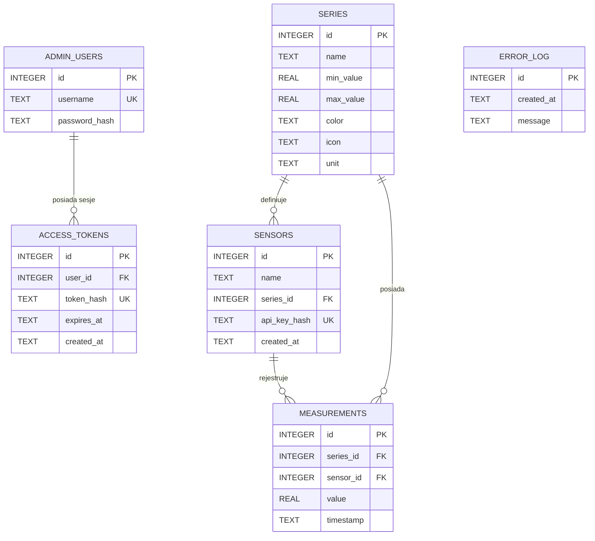

# Dokumentacja Projektu – ZAI 26Z (Serie Pomiarowe IoT)

**Autor:** Marcel Dybek  
**Temat projektu:** System zbierania i wizualizacji serii pomiarowych jakości powietrza (PM2.5, PM10, NO2)  
**Technologie:** Java 17 (Spring Boot 3.3.5, Hibernate/JPA, SQLite/MySQL), React 18 (TypeScript, Vite), Docker  

---

## 1. Adres wdrożonej aplikacji i repozytorium

- **Adres publiczny aplikacji (frontend):** `https://...` *(uzupełnij po wdrożeniu)*
- **Adres publiczny API (backend):** `https://.../api` *(uzupełnij po wdrożeniu)*
- **Link do repozytorium Git:** `https://github.com/MDybek/zai-26z`

---

## 2. Dane logowania konta administratora

- **Nazwa użytkownika:** `admin`
- **Hasło:** `Admin123!`

---

## 3. Instrukcja lokalnego uruchomienia

### Wymagane narzędzia
- Docker & Docker Compose (v2+) **lub**:
  - JDK 17+ (Eclipse Temurin / OpenJDK)
  - Node.js 20+ i npm 10+
  - Python 3.9+ (dla emulatora czujników `sensor.py`)

### Uruchomienie za pomocą Docker Compose (Zalecane)
W katalogu głównym projektu wykonaj:
```bash
docker compose up --build
```
- Aplikacja (Frontend): `http://localhost:3000`
- API (Backend): `http://localhost:8080`
- Endpoint stanu zdrowia: `http://localhost:8080/api/health`

### Uruchomienie ręczne

#### Backend:
```bash
cd backend
./mvnw spring-boot:run
```

#### Frontend:
```bash
cd frontend
npm install
npm run dev
```

### Uruchomienie testów
Do automatycznego uruchomienia testów służy skrypt `test.sh` w katalogu głównym:
```bash
./test.sh --backend    # Testy jednostkowe i integracyjne backendu (Maven)
./test.sh --frontend   # Weryfikacja typowania i budowanie frontendu (Vite)
./test.sh --contract   # Oficjalne testy kontraktowe zai-tests.mjs
```

### Generator danych z czujników (`sensor.py`)
Skrypt `sensor.py` przesyła pomiary wyłącznie przez API (`POST /api/measurements` z nagłówkiem `X-API-Key`).

```bash
# Automatyczne zainicjalizowanie 3 serii (PM2.5, PM10, NO2) i 16 pomiarów (wymóg F11):
python3 sensor.py

# Ręczne przesłanie pomiarów z własnym kluczem czujnika:
python3 sensor.py --api http://localhost:8080 --api-key "<KLUCZ_API>" --count 16 --mode sine

# Tryb ciągły (live stream co 5 sekund):
python3 sensor.py --api http://localhost:8080 --api-key "<KLUCZ_API>" --live --interval 5

# Pobieranie rzeczywistych danych pogodowych z Open-Meteo API (+2 pkt bonus):
python3 sensor.py --api http://localhost:8080 --api-key "<KLUCZ_API>" --source open-meteo --pollutant pm2_5
```

---

## 4. Diagram ERD i opis struktury bazy danych



- **`admin_users`**: Przechowuje konta administratorów z hasłami zahaszowanymi algorytmem BCrypt.
- **`access_tokens`**: Przechowuje aktywne tokeny sesyjne Bearer (w bazie wyłącznie skrót SHA-256 tokenu z czasem wygaśnięcia).
- **`series`**: Definiuje parametry serii pomiarowej: dopuszczalny przedział (`min_value`, `max_value`), kolor HEX oraz jednostkę.
- **`sensors`**: Reprezentuje zarejestrowane sensory. Klucz API czujnika przechowywany jest wyłącznie jako skrót SHA-256 (`api_key_hash`) i nigdy nie jest ujawniany po rejestracji.
- **`measurements`**: Niezmienna tabela wyników pomiarów powiązana kluczem obcym z serią i sensorem. Zaopatrzona w indeksy złożone `(series_id, timestamp)`.
- **`error_log`**: Rejestruje odrzucone wyniki pomiarów (spoza zakresu serii lub z przyszłości).

---

## 5. Dwa wybrane elementy bezpieczeństwa (T5)

### Element 1: Bezpieczne haszowanie haseł i kluczy API (T5.1 i T5.5)
- **Gdzie w kodzie:** `backend/src/main/java/pl/zai/airquality/security/PasswordEncoderConfig.java`, `Hashing.java`, `SensorService.java`
- **Przed czym chroni:** Zapobiega wyciekowi poświadczeń w przypadku nieautoryzowanego dostępu do zrzutu bazy danych. Hasła administratorów są zabezpieczone funkcją skrótu BCrypt z solą (koszt 10). Klucze API czujników są generowane losowo (kryptograficzny ciąg 32 znaków) i w bazie zapisywany jest wyłącznie skrót SHA-256. Nawet posiadając odczyt z bazy danych, atakujący nie pozna klucza czujnika ani hasła administratora.

### Element 2: Ochrona przed atakami wstrzyknięć i autoryzacja po stronie serwera (T5.2 i T5.4)
- **Gdzie w kodzie:** `backend/src/main/java/pl/zai/airquality/repo/*`, `BearerAuthenticationFilter.java`, `SecurityConfig.java`
- **Przed czym chroni:** Wszystkie zapytania bazodanowe wykonywane są przez parametryzowany ORM Spring Data JPA / Hibernate, co eliminuje podatności SQL Injection. Wszelkie operacje modyfikujące (POST/PUT/DELETE na seriach i sensorach) są chronione filtrem autoryzacyjnym na poziomie serwera, sprawdzającym ważność tokenu Bearer. Niemożliwe jest wykonanie operacji administracyjnej poprzez samo ominięcie interfejsu użytkownika.

---

## 6. Rozszerzenia kontraktu API

1. **Endpoint `GET /api/health`**: Zwraca status `{"status":"ok"}` wykorzystywany przez mechanizm healthcheck kontenerów Docker.
2. **Nagłówki ciasteczek sesyjnych**: Endpoint `/api/auth/login` oprócz tokenu w ciele JSON ustawia flagi `HttpOnly`, `Secure` oraz `SameSite=Strict`.
3. **Nagłówki bezpieczeństwa**: Zwracanie `X-Content-Type-Options: nosniff` oraz restrykcyjnej polityki `Content-Security-Policy`.

---

## 7. Deklaracja użycia narzędzi AI

Podczas realizacji projektu wykorzystano asystenta AI (Antigravity / Gemini) jako narzędzie wspierające w procesie:
- Weryfikacji zgodności implementacji z oficjalną specyfikacją kontraktu OpenAPI (`zai-api-26z.yaml`) i zestawem testów `zai-tests.mjs`.
- Generowania szablonów konfiguracji wieloetapowych obrazów Docker i pipeline'u GitHub Actions.
- Przeglądu kodu pod kątem bezpieczeństwa i dostępności WCAG 2.2 AA.

*Całość kodu, architektura i logika biznesowa zostały przetestowane i zweryfikowane pod kątem poprawności i bezpieczeństwa.*
